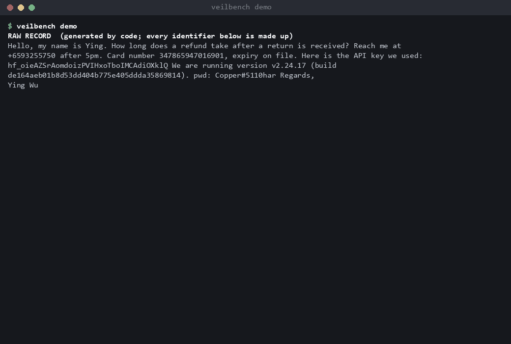
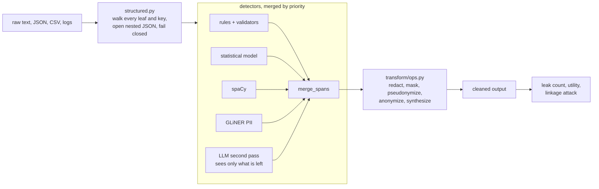

# veilbench

[](https://github.com/Exalt24/veilbench/actions/workflows/ci.yml)

Finds personal data and secrets in raw data, removes them five ways, and measures what each way costs and leaks.



*A real run of `veilbench demo`: one generated ticket, what the detector found, and the text after each technique. The version string and the commit hash are left alone. The frames are the command's own output at its real pace ([`scripts/make_demo_gif.py`](scripts/make_demo_gif.py)).*

**Proof:** on 800 generated records with 4,512 labelled identifiers, rules plus a statistical model leave an identifier readable in 5% of redacted records (39 of 800), against 59% for rules alone. On three layouts that model never trained on the same configuration leaves one in 37% of 300 records, and spaCy added to it brings that to 18%. 110 tests pass, and a mutation check that breaks the code one guard at a time is caught by a real test failure 44 times out of 44 ([`test-runs/mutation_check.txt`](docs/test-runs/mutation_check.txt)). CI: [green on `main`](https://github.com/Exalt24/veilbench/actions/workflows/ci.yml).

## What it is

Data that goes into training, evaluation or a synthetic data generator has to be cleaned first, and a cleaner is only as good as its worst miss. This repo builds the cleaner and then tries to break it: detectors compared against each other on recall, precision, latency and cost, a leak counted on the output and not on the labels, a pipeline pushed through odd formats and hidden fields, and a linkage attack run against the anonymized data.

**What the corpus is.** Every record is written by seeded code in [`veilbench/corpus/`](veilbench/corpus/): people from nine name cultures (Philippine and Spanish among them), with e-mails, phone numbers in four countries, addresses, national ID shapes with their real check digits, Luhn valid card numbers, IBANs that pass mod 97, API keys in nine vendor shapes and as generic tokens, and JWTs. They appear in support tickets, call transcripts, JSON with six schema layouts, CSV with five, log lines and file listings, together with look-alikes that are not identifiers (order numbers, version strings, commit hashes, UUIDs, timestamps). The ground truth is recorded while the text is built, so every span offset is exact. No real person's data was used anywhere.

## Measured results

Command: `veilbench benchmark` (raw output, per type, per slice and the predictions: [`docs/test-runs/benchmark.md`](docs/test-runs/benchmark.md), [`benchmark.json`](docs/test-runs/benchmark.json)). Corpus: 800 records, 4,512 labelled spans, 1,849 hard negatives, seed 7, sha256 `cba2e93e7d815941`. A span counts as found when it has the right type and at least half overlap. F2 weights recall four times as much as precision. "Readable after redaction" means an identifier of the record can still be read in the output; it is the number that matters, and it is counted on the text, not on the labels.

| configuration | precision | recall | F2 | readable after redaction | hard negatives flagged | p50 ms | p95 ms | compute s per 1,000 records |
|---|---|---|---|---|---|---|---|---|
| rules | 0.989 | 0.825 | 0.853 | 59% | 0% | 0.29 | 0.73 | 0.35 |
| rules + statistical model | 0.873 | 0.953 | 0.936 | 5% | 2% | 11.2 | 13.9 | 11.5 |
| rules + statistical model + spaCy | 0.731 | 0.954 | 0.899 | 5% | 13% | 22.8 | 37.2 | 24.3 |
| rules + statistical model + GLiNER PII | 0.711 | 0.956 | 0.894 | 4% | 59% | 81.4 | 188.8 | 95.6 |
| spaCy alone | 0.295 | 0.218 | 0.230 | 98% | 10% | 11.7 | 23.6 | 12.8 |
| GLiNER PII alone | 0.641 | 0.591 | 0.600 | 77% | 58% | 70.0 | 175.4 | 84.1 |

Latency is wall time per record on one 16 core CPU, no GPU. The models are `en_core_web_sm` and `xx_ent_wiki_sm` (spaCy 3.8) and `knowledgator/gliner-pii-small-v1.0` (Apache 2.0).

**The LLM second pass, on 27 records.** `openai/gpt-oss-120b` (Groq) is shown the text with everything the other detectors found replaced by `[X]`, and lists what is still there. The free key's token limits are shared with other work, so only the first 27 of the 800 records could be scored; every configuration is scored again on those same 27 in the last table of [`benchmark.md`](docs/test-runs/benchmark.md). On them, rules + statistical model + GLiNER leave an identifier readable in 3 of 27 records, and adding the LLM pass leaves 0 of 27. Recall goes from 0.938 to 0.959 and F2 from 0.885 to 0.901. The price is time and money: p50 681 ms against 70 ms, and about $0.08 per 1,000 records at the list price of $0.15 per million input tokens and $0.60 per million output tokens, read from the model's Groq page on 2026-11-28. Twenty seven records show what the pass does, not how often. Its answers are kept as character offsets in [`llm_cache.jsonl`](docs/test-runs/llm_cache.jsonl), so the table can be rebuilt without a key.

**The statistical model was trained on this generator, so read the next table too.** It learned from 1,500 other generated records using four of the nine name cultures and some of the templates, but it shares the generator's way of writing, and its scores above are in that sense friendly. [`docs/test-runs/benchmark_ood.md`](docs/test-runs/benchmark_ood.md) scores the same configurations on 300 records in three layouts it never trained on (a quoted e-mail thread, meeting notes, a chat export; 2,350 spans, seed 17):

| configuration | precision | recall | F2 | readable after redaction |
|---|---|---|---|---|
| rules | 0.934 | 0.673 | 0.713 | 87% |
| rules + statistical model | 0.753 | 0.843 | 0.823 | 37% |
| rules + statistical model + spaCy | 0.659 | 0.878 | 0.823 | 18% |
| rules + statistical model + GLiNER PII | 0.712 | 0.893 | 0.850 | 31% |

The per type and per slice tables of both reports show where each detector wins. Rules are exact on validated identifiers (cards, IBANs, keys, e-mail, IP) and weak on names (recall 0.54) and addresses inside file paths. The statistical model fixes names but does not read a name written into a file name (the filename slice is where every configuration is weakest). GLiNER flags look-alikes freely: 59% of the hard negatives, so its precision on IBANs is 0.29.

### Schema drift, hidden fields, odd formats

[`veilbench/structured.py`](veilbench/structured.py) never assumes which field holds what: it walks every JSON value and key, opens a string that is itself JSON (a `payload` column holding a key), treats a column that is mostly one entity type as that type for its quiet rows, uses a field name as a hint and never as a requirement, and falls back to a plain text pass if a structured step fails. On the 192 JSON and 80 CSV records (six and five layouts, keys renamed to `f1` or `Nme`, a name inside a notes field, a key inside an escaped JSON string) with the rules alone, it leaves an identifier readable in 107 JSON records against 137 for a flat text pass, and in 61 CSV records against 69 ([`robustness.json`](docs/test-runs/robustness.json)). With the statistical model added both paths leave 0 of 272, so on this corpus the extra structure buys nothing and costs about 17 times the time.

### The five techniques, measured on a downstream task

1,200 generated tickets (250 customers, 360 held out) through each technique with ground truth spans ([`utility.json`](docs/test-runs/utility.json)). The classifier predicts one of six ticket categories; the join key is the account e-mail, and 246 distinct customers are present.

| technique | classifier accuracy | distinct customers the join key still gives |
|---|---|---|
| raw text | 0.775 | 246 |
| redact | 0.817 | 1 |
| mask | 0.808 | 241 |
| pseudonymize | 0.786 | 246 |
| anonymize (generalize) | 0.814 | 6 |
| synthesize | 0.792 | 1,197 |

Removing identifiers did not hurt the classifier here, because they are noise for a category prediction. What the techniques differ on is the join: pseudonyms keep it exactly, everything else breaks it one way or another. [`docs/DECISIONS.md`](docs/DECISIONS.md) says when each one fits and what it costs.

### Privacy techniques and an attack on them

All on a generated population of 3,000 people with zip, birth year and gender, and an attacker who holds a named list of everyone ([`privacy.json`](docs/test-runs/privacy.json)):

- **Linkage attack.** On 1,513 released rows with exact values the attacker re-identifies 722 (47.7%); 61.3% of rows are unique and the measured k is 1. After Mondrian k-anonymity the measured k is 5 and no row is re-identified; the chance of guessing the right person falls from 66.4% to 8.8% for the average row, at 4.6% information loss. k of 25 costs 21.2%.
- **Differential privacy.** A Laplace count at epsilon 1 is off by 1.00 on average (theory 1.00), at epsilon 0.1 by 9.9 (theory 10), measured over 20,000 draws each, with no measurable bias. The same noise defends against a membership attack: from a noisy table the attacker is right 100% of the time at no noise, 70% at epsilon 1 and 52% at epsilon 0.1 (chance is 50%).
- **Format preserving masking.** Digit identifiers are encrypted with FF1 (NIST SP 800-38G), which reproduces the published sample vectors in [`tests/test_ids_and_fpe.py`](tests/test_ids_and_fpe.py); the output keeps its separators, a card stays Luhn valid and an IBAN still validates.
- **Names across documents.** `Maria Santos`, `SANTOS, MARIA`, `María Santos`, `M. Santos` and `Maria S.` get one pseudonym, and `Mario Santos` does not. At the stated threshold of 0.96, 80.9% of 2,150 name variants land in their person's cluster and none of 30 near twin pairs merge. A threshold of 0.90 recovers 90.3% and merges 24 twins ([`cross_document_names.json`](docs/test-runs/cross_document_names.json)).

## How it fits together



## Run it

You need Python 3.11 or newer. Nothing needs an account. The GLiNER weights (326 MB) download from Hugging Face on first use, and the LLM pass needs a `GROQ_API_KEY` in the environment and is skipped without it.

```
python -m venv .venv
.venv\Scripts\activate          # Windows
source .venv/bin/activate       # macOS and Linux
pip install -e ".[dev,models]"
python -m spacy download en_core_web_sm && python -m spacy download xx_ent_wiki_sm
veilbench demo                  # one record through all five techniques
```

Each of these writes under `docs/test-runs/`:

```
veilbench corpus                           # statistics and the sha256 of the generated corpus
veilbench benchmark --no-llm               # the detector table above (a few minutes with the models)
veilbench benchmark --split ood --n 300 --seed 17 --no-llm
veilbench privacy                          # k-anonymity, differential privacy, the linkage attack
veilbench utility | xdoc | techniques | robustness
veilbench anonymize file.json --technique pseudonymize
```

A benchmark that is stopped (`--max-seconds`) resumes from the `.work/` folder.

## Tests

```
python -m pytest                           # 110 tests, about 20 seconds
python scripts/mutation_check.py           # breaks 44 guards one at a time, in a temporary copy
```

The suite mixes unit tests with Hypothesis property tests. With perfect detection no technique leaves an identifier of its own record readable, over random corpora. A pseudonym is the same every time under one key and almost never under another. Masking keeps length and punctuation. Every k-anonymous group has at least k rows, for any k and population. Laplace noise has no measurable bias and an error of 1/epsilon. FF1 matches the NIST vectors and decrypts back.

[`scripts/mutation_check.py`](scripts/mutation_check.py) removes one guard at a time (the Luhn check, a check letter, the key in the pseudonym hash, the split that keeps k rows, the noise scale, and 39 more) and requires a failing test for each. Its first full run left six mutants alive and one pointing at code that had changed. Two were guards made dead by another one and were deleted. Four had no test that reached them and got one. Output: [`docs/test-runs/mutation_check.txt`](docs/test-runs/mutation_check.txt).

## Limits

- **The corpus is generated by the same code that trains the statistical model.** Its scores are for that corpus and for the held-out layouts above. Treat them as a comparison between methods, not as a rate to expect on other data.
- **The rules have no name list.** A name is found only from a cue (a title, "my name is", a signature) or because its parts appear in an e-mail address elsewhere in the text. A lowercase token with no context is read as a hash, not a key. An address is found only in the layouts the patterns cover: US, Philippine and Spanish street forms, not an address written into a file path.
- **Typed matching is strict on boundaries.** An address cut short or a name with a title counts as a miss in the typed table, even when it hides the value. The "readable after redaction" column is the fairer measure and is why it is reported.
- **The LLM pass was measured on 27 records.** The free key allows a fixed number of tokens a day and a minute, shared with other work, so the claim for it is what it found in those records, not a rate.
- **Names cannot always be told apart.** A bare `Ms. Santos` that fits two people is linked to neither, and a rule cannot split a Spanish double surname, so cross document recall stops near 81%.
- **k-anonymity covers three columns.** It says nothing about a sensitive column shared by a whole group, or other columns an attacker holds.
- **Pseudonymized names need a stored map** to reverse, since they come from keyed hashing; digit identifiers decrypt with the key.
- **CPU only.** Latency is from one machine with 16 cores and no GPU; the structure aware path calls the model once per value.

## Stack

Python 3.13, NumPy, scikit-learn (the statistical detector and the utility classifier), `cryptography` (AES for FF1), spaCy, GLiNER, Hypothesis and pytest, and `openai/gpt-oss-120b` on Groq for the LLM pass.

## License

MIT, see [LICENSE](LICENSE).
